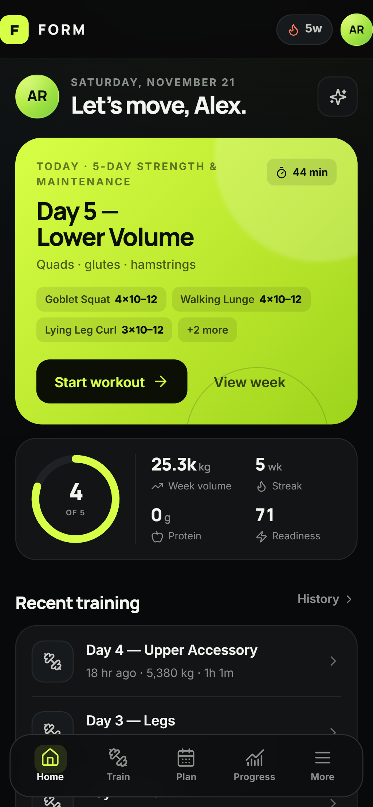
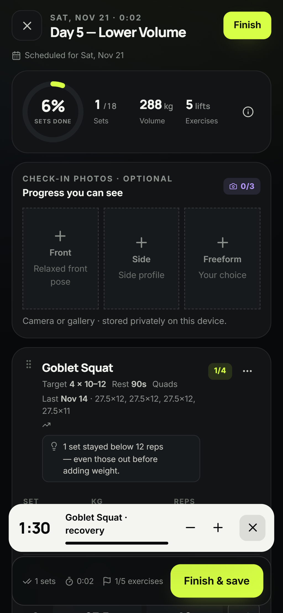
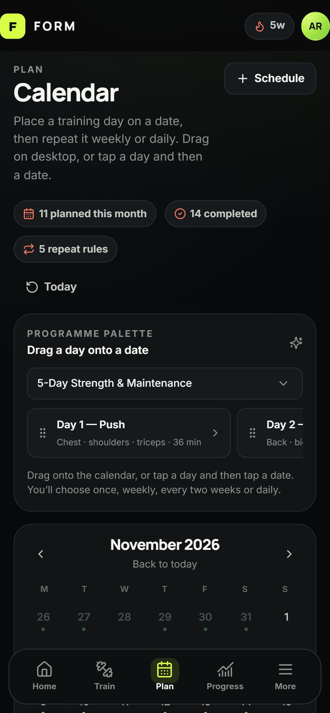
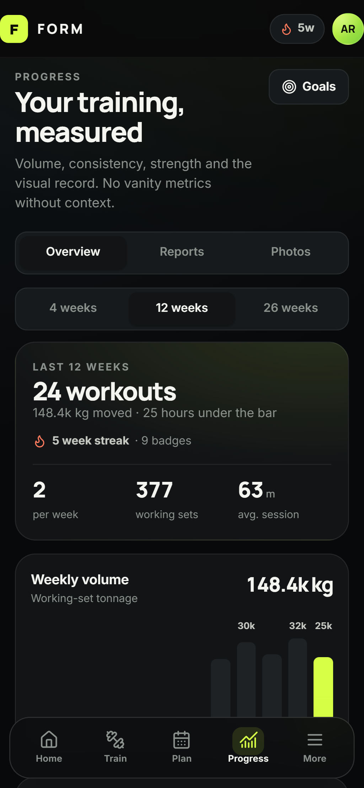
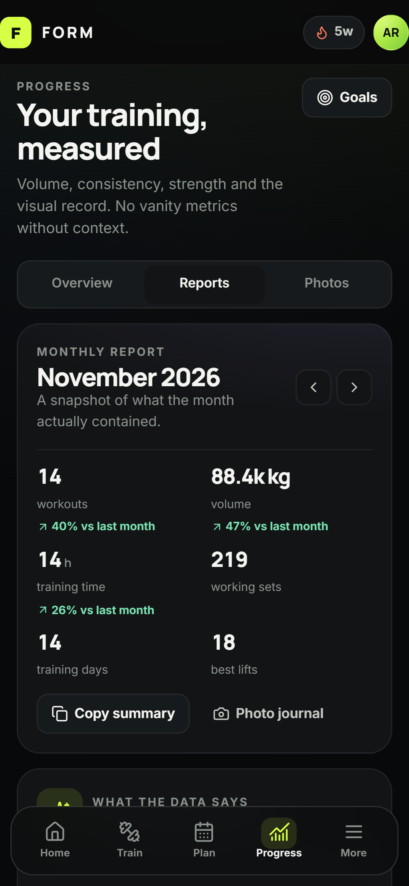
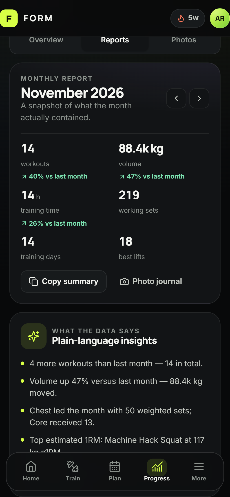
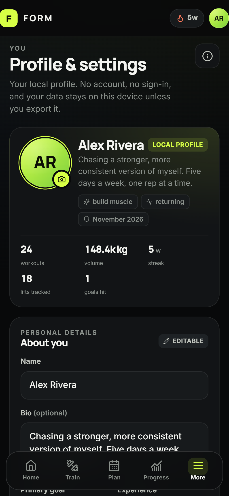
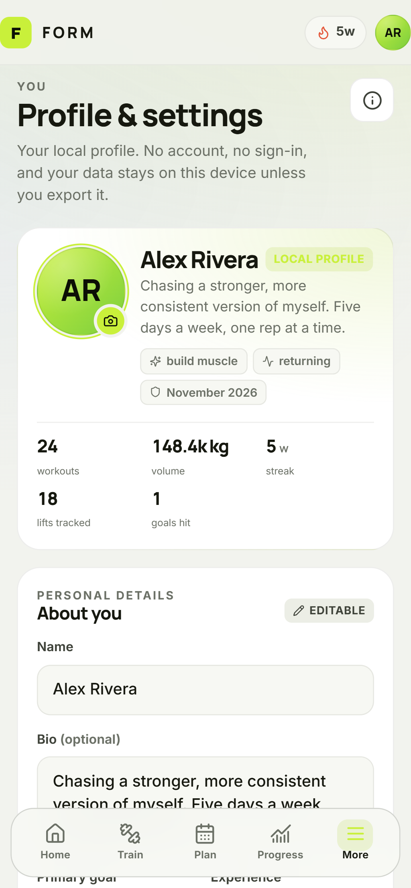
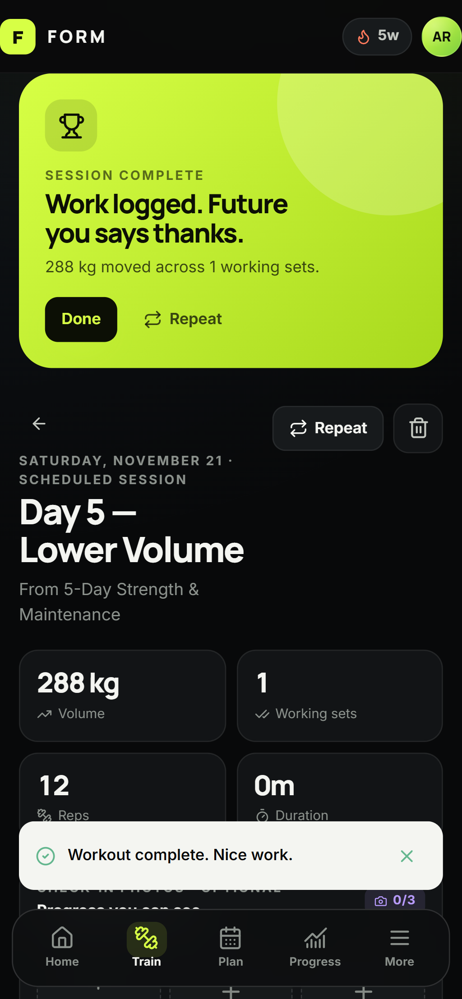

# FORM — train with intent

A polished, mobile-first personal fitness app built around **programming and logging workouts**. FORM is local-first: it opens with a ready-to-use profile, saves everything in the browser, and never asks you to create an account.

The core loop is deliberate:

**build a programme → place it on a repeating calendar → log the session → understand the result.**



## What is included

### Workouts (the core)
- Seed example: the supplied **5-Day Strength & Maintenance** Push / Pull / Legs / Upper Accessory / Lower Volume plan, imported as fully editable programme data.
- Create, rename, duplicate, delete and schedule programmes.
- Add, rename, reorder, duplicate and delete training days.
- Add/replace/reorder exercises; edit sets, rep ranges and rest; add per-exercise notes.
- 80+ exercise library entries with primary/secondary muscles, equipment, difficulty, technique cues and alternatives, plus custom exercises.
- Start a saved day or an empty/freestyle workout.
- Gym-friendly set logging: previous weights/reps are shown, inputs are large, one tap completes a set, warm-ups are marked separately, and rest starts automatically.
- Progression guidance: if every set last time hit the top of the rep range, the next session suggests a specific load increase; otherwise it tells you how many reps remain before adding weight.
- One-tap warm-up generator (40/60/80% ramp) and a barbell plate calculator for your current weight.
- Rest timer with ±15 seconds, skip, vibration where supported and a floating dock that survives page changes.
- Per-set RPE (optional), notes, weight adjustment for all sets, exercise replacement and session bodyweight.
- Session photos in three poses: **Front**, **Side** and **Freeform** (camera or gallery, compressed locally).
- Finish validation, completed-session summary, PR detection, repeat workout, delete.
- Session history with volume, time, sets, PRs and detail views.

### Planning
- Month calendar with planned, completed and missed sessions.
- **Drag a programme day onto a date** (desktop) or **tap a day then a date** (touch).
- Repeat once, weekly, every two weeks or daily; choose multiple weekdays and an optional end date.
- Pause, edit or delete repeating schedules; completed history remains.
- Week agenda, day agenda and a compact weekly plan.
- Duplicate a training day (with fresh exercise ids) as a starting point for a new variation.

### Progress and reports
- 4 / 12 / 26 week ranges.
- Workouts, volume, training time, working sets, PRs and average session.
- Weekly volume and consistency charts, muscle balance, bodyweight trend, personal bests and exercise sparklines.
- 12-week training rhythm heatmap.
- Monthly report with previous-month comparisons, weekly breakdown, top exercises, best lifts, longest session, plain-language insights and a copyable text summary.
- Private photo journal with pose filters and “then & now” comparisons.
- Achievements derived from real data (no invented unlocks).

### Food and body context
- Daily targets estimated from profile, goal and weekly training load, with manual overrides.
- Curated food database (70+ everyday foods) with search, categories, servings and meal slots.
- Quick-add calories/macros, saved meals, one-tap meal logging and **copy the previous day** into today.
- Seven-day calorie chart with empty states.
- Daily check-in: weight, ten measurements, sleep, energy, soreness, mood and notes.
- Weight/sleep trends, readiness score and measurement summaries.

### Goals, learning and profile
- Goal types: workout count, weekly streak, total volume, bodyweight, lift target, personal.
- Automatic progress with deadlines and manual completion for custom goals.
- 14 achievements with progress states and earned dates.
- Nine original learning articles across Training / Nutrition / Recovery / Mindset, with technique cues, tips, sources and external video links.
- Profile with photo, personal details, units, weekly target and training preferences.
- Dark / light / system themes, default rest timer, auto-rest, RPE and haptics settings.
- JSON export/import (including photos), sample history for exploring charts, and a full reset.
- Installable PWA with 192/512/maskable PNG icons, Apple touch icon and an offline app-shell service worker.
- Training Circle page: a deliberately honest, local-only approach to community — no fake leaderboard, plus a personal weekly challenge and copyable session summary.

## Screens

| Home status | Active session | Calendar |
| --- | --- | --- |
|  |  |  |

| Progress | Monthly report | Insights |
| --- | --- | --- |
|  |  |  |

| Profile | Light theme | Session complete |
| --- | --- | --- |
|  |  |  |

More screens: [Food diary](docs/screenshots/food.png) · [Active session](docs/screenshots/session.png) · [Desktop home](docs/screenshots/desktop-home.png) · [Desktop calendar](docs/screenshots/desktop-calendar.png)

## Run it

Requirements: **Node.js 22+**, npm, and a modern browser. The E2E suite uses the locally installed Google Chrome (`channel: 'chrome'`); no Playwright browser download is needed.

```bash
npm install
npm run dev        # http://localhost:5173
npm run build      # production build in dist/
npm run preview    # serve the production build at http://localhost:4173
```

The npm scripts use `scripts/run.mjs`, which pins `TMP`/`TEMP` to the project for environments where the esbuild service cannot clean its system-temp output. This keeps the build reproducible on Windows without changing app code.

### Tests

```bash
npm run lint             # TypeScript strict check
npm test                 # 43 Vitest unit/integration tests
npm run test:e2e         # 35 Playwright checks in Chrome: flows, responsive pages, console errors
npm run test:e2e:prod    # production build + service worker smoke test
npm run verify           # all of the above, plus build
```

The browser suite covers: logging a workout and reloading it, progression guidance from a previous session, warm-up/plate tools, food logging and copying a day, diary check-in, goal creation, tap-to-schedule, desktop drag-and-drop, photo upload, light theme, JSON export/import, sample history/report and empty-workout validation. It also renders every screen at mobile width, verifies no horizontal overflow at 360px, runs the desktop layout, asserts there are no page/console errors, and captures the screenshots used in this README. A separate production run verifies the built bundle, PWA icons and service worker.

## Data and privacy

| Data | Storage |
| --- | --- |
| Profile, programmes, sessions, schedule, food, diary, goals, settings | `localStorage` key `form-app-v1` |
| Profile avatar | compressed data URL inside the profile |
| Session photos | IndexedDB database `form-photos`, store `photos` |

- No network calls are made for user data. There is no sync server.
- Export a backup from **Profile → Export backup (JSON)** before clearing browser data. The export includes photo bytes.
- **Add sample history** is available only before real workouts exist and adds five weeks of backdated sessions/check-ins for exploring reports. Sample entries are tagged in History and can be removed from Profile with one action; **Reset all data** removes everything.
- Clearing site data in the browser is permanent — the export is the recovery path.

## Architecture

```text
src/
  data/          exercises, foods, articles, seeded example programme/profile/schedule
  lib/           units, dates, workout maths, schedule expansion, stats, reports, nutrition,
                 goals, achievements, photo IndexedDB, demo history
  store/         Zustand persisted app store + toast store
  components/    app shell, UI primitives, charts, workout logger, photo strip, exercise picker
  pages/         Home, Workouts, Programme detail/editor, Library/detail, Session, History/detail,
                 Calendar, Progress, Food, Diary, Goals, Learn/Article, Profile, More, Circle
  styles/        design tokens, base, components, page layouts
e2e/             Playwright flows, responsive renders, production smoke test
docs/            research notes and screenshots
```

- **React 19 + TypeScript + Vite 7**, React Router, Zustand, date-fns, lucide icons, custom SVG charts.
- Pages are route-level code-split; the production entry is ~118 kB gzipped.
- Mobile: floating bottom navigation, safe-area padding, 44px+ targets, touch-friendly pickers. Desktop: persistent sidebar and wider grids.
- Fonts are bundled locally (Manrope + Inter) so the app works offline and does not depend on third-party font requests.
- A basic service worker caches the built shell/assets; app data is already local.
- PNG app icons are generated reproducibly with `node scripts/make-icons.mjs` (Playwright + the installed Chrome).

## Seed data

On first run FORM creates:

1. A local profile (“Alex Rivera”) with goal, experience, height/weight and a five-session weekly target. No sign-in is required or available.
2. The example five-day programme from the supplied reference image, including warm-up/rest/progression notes and the exact day structure (with “Pump”/“Chest Press (Light)” mapped to suitable library lifts).
3. Weekly schedule rules for Monday, Tuesday, Thursday, Friday and Saturday.

The programme is ordinary data: rename it, remove exercises, duplicate it, reschedule it, or delete it without affecting application logic.

## Scope and honest limitations

- **Local-only by design.** There are no accounts, cloud sync, feeds or global leaderboards. The Circle page explains this rather than simulating a community.
- Food values are sensible approximations from a curated set; this is not a barcode database and nutrition targets are estimates, not medical advice.
- Measurement/readiness scores are contextual cues, not clinical assessments.
- One active session at a time. Repeating rules are whole-rule edits; there is no per-occurrence skip/override yet (pause or delete the rule).
- Offline caching is intentionally simple: the app shell and static build assets are cached; first launch still needs the server.
- Photos are compressed (session max 1080px, avatar 512px) to keep local storage practical; extremely large libraries of photos will eventually hit browser quota.

## Research and credits

- Product research is documented in [docs/RESEARCH.md](docs/RESEARCH.md), based on public pages for [Hevy](https://www.hevyapp.com/features/), [Strong](https://www.strong.app/), [Boostcamp](https://www.boostcamp.app/), JEFIT, the MYBOD store listing and the supplied reference pack.
- The example training plan came from the provided reference image. All UI, copy, articles, charts and interactions were created for this project; no proprietary MYBOD assets or branding are used.
- The learning library cites established public resources (ACSM, Examine, Sleep Foundation, WHO and respected coaching channels). Articles are general information, not medical advice.
